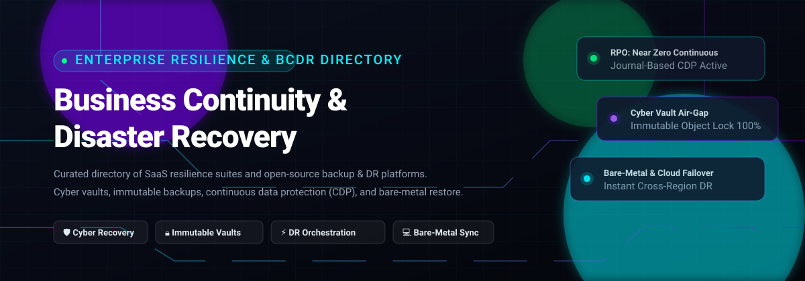

<p align="center">
  
</p>

# 🛡️ Awesome Business Continuity & Disaster Recovery (BCDR)

<p align="center">
  <a href="https://github.com/ishandutta2007/Awesome-Awesome-Awesome"></a>
  <a href="https://discord.gg/jc4xtF58Ve"></a>
  <a href="https://github.com/ishandutta2007/Awesome-Business-Continuity-Disaster-Recovery/stargazers"></a>
  <a href="https://github.com/ishandutta2007/Awesome-Business-Continuity-Disaster-Recovery/network/members"></a>
  <a href="https://github.com/ishandutta2007/Awesome-Business-Continuity-Disaster-Recovery/issues"></a>
  <a href="https://github.com/ishandutta2007/Awesome-Business-Continuity-Disaster-Recovery/blob/main/LICENSE"></a>
  <a href="https://github.com/ishandutta2007"></a>
</p>

> **A curated, battle-tested directory of enterprise SaaS solutions and open-source GitHub projects for Business Continuity, Disaster Recovery (BCDR), Cyber Recovery, Air-Gapped Immutable Backups, and Near-Zero RPO/RTO Failover.** 🌟 Star if you find this valuable! 🌟

---

## 📑 Table of Contents

- [🌐 Sector Overview & Market Dynamics](#-sector-overview--market-dynamics)
- [☁️ Enterprise SaaS & Hosted BCDR Platforms](#️-enterprise-saas--hosted-bcdr-platforms)
- [🔓 Open-Source GitHub Projects](#-open-source-github-projects)
  - [📦 Core Backup Engines & Immutability](#-core-backup-engines--immutability)
  - [🖥️ Bare-Metal Recovery & System Migration](#️-bare-metal-recovery--system-migration)
  - [☸️ Kubernetes & Container Disaster Recovery](#️-kubernetes--container-disaster-recovery)
  - [🗄️ Database Backup & Point-in-Time Recovery (PITR)](#️-database-backup--point-in-time-recovery-pitr)
  - [🔍 DR Posture Validation & Runbook Automation](#-dr-posture-validation--runbook-automation)
  - [🔄 Replication, Distributed Storage & Network Backups](#-replication-distributed-storage--network-backups)
- [🧩 BCDR Architecture Matrix: Choosing the Right Layer](#-bcdr-architecture-matrix-choosing-the-right-layer)
- [🤝 How to Contribute](#-how-to-contribute)
- [☕ Support](#-support)
- [⚖️ Disclaimer & Security Guidance](#️-disclaimer--security-guidance)
- [📈 Star History](#-star-history)

---

## 🌐 Sector Overview & Market Dynamics

The global **Business Continuity and Disaster Recovery (BCDR)** and Disaster Recovery-as-a-Service (DRaaS) market is valued at approximately **$14.5 Billion to $18.2 Billion**, expanding at an aggressive CAGR of over 25–30% driven by escalating enterprise ransomware attacks, strict data sovereignty regulations (e.g., EU DORA, NIS2, SEC cyber disclosure rules), and multi-cloud operational risks. 

From a structural perspective, the sector is **moderately concentrated at the infrastructure and enterprise software tier**—where a handful of dominant public cloud hyperscalers (Microsoft, AWS) and data resiliency leaders (Veeam, Rubrik, Cohesity, Commvault) capture the lion's share of large-enterprise budgets—yet **remains highly fragmented across the broader ecosystem**, where thousands of regional Managed Service Providers (MSPs), niche DRaaS vendors, governance platforms, and specialized backup utilities serve localized and industry-specific resilience requirements.

---

## ☁️ Enterprise SaaS & Hosted BCDR Platforms

*Sorted in descending order by company valuation / revenue scale.*

| Product | Company Size (Valuation / Revenue) | Starting Price (Specific Tier) | Free Tier / Trial Limits | Key Capabilities & Architecture |
| :--- | :--- | :--- | :--- | :--- |
| **[Azure Site Recovery](https://azure.microsoft.com/en-us/products/site-recovery)** | **~$3.1 Trillion** market cap (Microsoft); cloud division revenue >$100B/yr | **$25.00** per protected instance/month (to Azure) / **$16.00** per instance/month (to secondary customer site) | **31-day free trial per instance** (management fee waived; standard compute, network egress, and replica storage charges apply) | Orchestrates automated replication, failover drills, and live failbacks for VMware, Hyper-V, and physical servers directly into Azure regions. |
| **[AWS Elastic Disaster Recovery (DRS)](https://aws.amazon.com/disaster-recovery/)** | **~$2.0 Trillion** market cap (Amazon); AWS revenue >$105B/yr | **$0.028** per replicated server per hour (~$20.16/month per server) | **90-day free trial per server** (waives $0.028/hr software fee for 2,160 hours; underlying staging EBS and snapshot storage bill separately) | Continuous block-level replication into a low-cost staging area in AWS; spins up target EC2 instances on-demand during recovery drills or live outages. |
| **[Snowflake Account Failover](https://www.snowflake.com/)** | **~$45 Billion – $55 Billion** market cap; FY2025 revenue >$3.6B | Requires **Business Critical Edition** starting at **$4.00 per credit** (plus replication compute-hours and inter-region data transfer fees) | **30-day free trial with $400 credits** (valid across Standard/Enterprise; trial upgrade to Business Critical required for failover testing) | Mission-critical cross-cloud and cross-region replication of databases, schemas, users, roles, and automated client redirect for continuous data cloud availability. |
| **[Veeam](https://www.veeam.com/)** | **$15.0 Billion** valuation; >$1.7B Annualized Recurring Revenue (ARR) | **$155.00** per workload per year (Veeam Universal License / VUL Foundation tier) | **Free forever: Veeam Community Edition** capped at **10 workloads/instances** (includes 500GB free NAS backup per job; max 5TB total pool) | Comprehensive hybrid-cloud backup, ransomware air-gapping, automated SureBackup verification, and VM/NAS recovery across VMware, Hyper-V, Nutanix, and cloud workloads. |
| **[Rubrik](https://www.rubrik.com/)** | **$11.0 Billion – $15.0 Billion** market cap (NYSE: RBRK); >$1.09B ARR | **$130.00** per Billable Encrypted Terabyte (BETB) per month (Foundation Edition, 3-year subscription commitment) | **Proof-of-Concept / Hosted SaaS Trial** available via partner/sales portal, scoped up to **500 users and 10 TB Data Protection Capacity** | Zero Trust Data Security platform featuring immutable append-only cyber vaults, automated anomaly/ransomware detection, and sensitive data discovery. |
| **[Cohesity](https://www.cohesity.com/)** | **$7.0 Billion – $8.0 Billion** valuation; ~$1.5B ARR / ~$1.7B pro-forma revenue (post-Veritas NetBackup combination) | Custom capacity-based enterprise quote starting around **$90.00 – $150.00** per managed TB per year (plus node/cloud infrastructure) | **30-day free trial** for Cohesity Cloud Services / Backup as a Service (BaaS) with hybrid workload support upon sales qualification | Web-scale, scale-out architectural data protection and CyberScan threat intelligence with immutable snapshots and Cleanroom recovery environments. |
| **[Commvault Cloud](https://www.commvault.com/)** | **~$5.5 Billion – $7.0 Billion** market cap (NASDAQ: CVLT); >$1.03B annual revenue | **$1.70** per user per month (Microsoft 365 Cloud Backup baseline) or custom consumption per workload TB | **30-day full-feature free trial** (unrestricted hybrid workloads including M365, VMs, databases, and containers with zero credit card required) | Enterprise cyber resilience platform powered by Metallic AI; provides autonomous data recovery, air-gapped Cloud Command vaults, and cleanroom orchestration. |
| **[Datto BCDR](https://www.datto.com/)** (Kaseya) | **$6.2 Billion** enterprise valuation upon acquisition; parent Kaseya ARR >$1.5B | **$2.00 – $3.00** per user/month (SaaS Protection) or **$500.00 – $1,000.00+** monthly service fee for SIRIS BCDR appliances | **14-day free trial** available for Datto management modules (scoped up to 500 test endpoints); SIRIS appliance evaluations arranged via MSP partners | Turnkey BCDR hardware/software appliance built specifically for MSPs and SMBs featuring image-based inverse V snap technology and instant local/cloud cloud virtualization. |
| **[Zerto](https://www.zerto.com/)** (HPE) | Part of Hewlett Packard Enterprise (**~$24 Billion** market cap); Zerto standalone enterprise valuation ~$374M | **$1,000.00 – $1,400.00** per protected VM per year (Enterprise Cloud Edition baseline) | **14-day free trial** capped at **15 Virtual Machines (VMs)** (includes full journal-based Continuous Data Protection and failover orchestration) | Industry-leading Continuous Data Protection (CDP) using block-level journal-based recovery for seconds-level RPO and minutes-level RTO without hypervisor snapshots. |
| **[Druva](https://www.druva.com/)** | **~$2.0 Billion – $3.0 Billion** valuation; >$200M SaaS ARR | **$7.00** per user per month (Endpoints/M365) or **$210.00** per TB per month (Druva Phoenix data center / VM backup) | **30-day self-service free trial** (protect live workloads across AWS, M365, endpoints, and VMs with no credit card upfront) | 100% SaaS-based, cloud-native resiliency cloud built on AWS; delivers agentless backup, micro-sharded encrypted deduplication, and automated ransomware quarantines. |

---

## 🔓 Open-Source GitHub Projects

*Open-source projects categorized by recovery architecture and sorted in descending order by GitHub Stars.*

### 📦 Core Backup Engines & Immutability

| Project | Stars | Tech Stack | License | Core Capabilities & Trade-Offs |
| :--- | :---: | :--- | :--- | :--- |
| **[Restic](https://github.com/restic/restic)** | [](https://github.com/restic/restic/stargazers) | Go | BSD-2-Clause | **The benchmark open-source backup engine.** Features client-side authenticated AES-256 encryption by default, content-defined chunk deduplication, and single-binary portability with direct support for S3, B2, Azure, and GCS.<br>⚠️ *Trade-off: CLI only; lacks built-in job scheduling or full bare-metal OS recovery.* |
| **[Duplicati](https://github.com/duplicati/duplicati)** | [](https://github.com/duplicati/duplicati/stargazers) | C# (.NET) | LGPL-2.1 | User-friendly, web-based backup manager supporting encrypted and incremental backups to dozens of cloud backends (Google Drive, OneDrive, S3, WebDAV) with built-in scheduling.<br>⚠️ *Trade-off: Database SQLite catalog overhead can slow large restore operations.* |
| **[Kopia](https://github.com/kopia/kopia)** | [](https://github.com/kopia/kopia/stargazers) | Go | Apache-2.0 | High-performance, cross-platform backup engine featuring client-side end-to-end encryption, deduplication, append-only repository mode, snapshot verification, and both a sleek GUI and CLI.<br>⚠️ *Trade-off: Focuses purely on file/snapshot data storage; lacks automated failover orchestration.* |
| **[BorgBackup](https://github.com/borgbackup/borg)** | [](https://github.com/borgbackup/borg/stargazers) | Python / C | BSD-3-Clause | Highly efficient deduplicating archiver with authenticated encryption (AES-256) and multiple compression algorithms (zstd, lz4). Supports append-only SSH repositories for ransomware resilience.<br>⚠️ *Trade-off: Native remote targets require Borg installed on destination SSH host; Unix-first.* |
| **[Garethgeorge Backrest](https://github.com/garethgeorge/backrest)** | [](https://github.com/garethgeorge/backrest/stargazers) | Go / Vue | GPL-3.0 | Modern, polished Web UI and orchestrator built on top of the Restic backup engine. Provides centralized scheduling, multi-repo tracking, snapshot browsing, and Discord/Slack alerts.<br>⚠️ *Trade-off: Acts as a management wrapper around Restic rather than a standalone storage engine.* |
| **[Bup](https://github.com/bup/bup)** | [](https://github.com/bup/bup/stargazers) | Python / C | GPL-2.0 | Highly efficient backup system based on the Git packfile format. Capable of handling raw disk images and multi-terabyte virtual machine disks using rolling checksum chunking.<br>⚠️ *Trade-off: Missing native built-in client-side encryption without third-party layered tooling.* |
| **[Borgmatic](https://github.com/borgmatic-collective/borgmatic)** | [](https://github.com/borgmatic-collective/borgmatic/stargazers) | Python | GPL-3.0 | Declarative configuration-driven orchestrator for BorgBackup. Automates database dumps (PostgreSQL, MySQL, SQLite, MongoDB), snapshot prune policies, integrity checks, and monitoring pings.<br>⚠️ *Trade-off: Relies directly on underlying Borg binaries and environment availability.* |

---

### 🖥️ Bare-Metal Recovery & System Migration

| Project | Stars | Tech Stack | License | Core Capabilities & Trade-Offs |
| :--- | :---: | :--- | :--- | :--- |
| **[Relax-and-Recover (ReaR)](https://github.com/rear/rear)** | [](https://github.com/rear/rear/stargazers) | Bash | GPL-3.0 | **The leading open-source bare-metal disaster recovery framework for Linux.** Creates a bootable rescue ISO/PXE image of the running system and reproduces partitioning, bootloaders, and network configs onto dissimilar hardware.<br>⚠️ *Trade-off: Steep learning curve; requires hands-on Linux kernel and storage configuration knowledge.* |

---

### ☸️ Kubernetes & Container Disaster Recovery

| Project | Stars | Tech Stack | License | Core Capabilities & Trade-Offs |
| :--- | :---: | :--- | :--- | :--- |
| **[Velero](https://github.com/velero-io/velero)** | [](https://github.com/velero-io/velero/stargazers) | Go | Apache-2.0 | **The industry standard for Kubernetes disaster recovery.** Backs up cluster state, CRDs, namespaces, and persistent storage volumes via CSI snapshots or Restic/Kopia integration. Powers multi-cluster migrations.<br>⚠️ *Trade-off: Scoped specifically to Kubernetes environments; requires cluster storage plugin configurations.* |
| **[OpenEBS](https://github.com/openebs/openebs)** | [](https://github.com/openebs/openebs/stargazers) | Go / C | Apache-2.0 | Kubernetes container-attached storage engine offering synchronous replication, volume snapshotting, and cross-AZ/cross-region disaster recovery for stateful cloud-native workloads.<br>⚠️ *Trade-off: Requires dedicated storage nodes and memory management within Kubernetes.* |
| **[Longhorn](https://github.com/longhorn/longhorn)** | [](https://github.com/longhorn/longhorn/stargazers) | Go | Apache-2.0 | Lightweight, reliable distributed block storage system for Kubernetes with built-in asynchronous disaster recovery volumes and periodic secondary backup sync to NFS or S3 targets.<br>⚠️ *Trade-off: High IOPS overhead compared to bare raw NVMe CSI drivers.* |

---

### 🗄️ Database Backup & Point-in-Time Recovery (PITR)

| Project | Stars | Tech Stack | License | Core Capabilities & Trade-Offs |
| :--- | :---: | :--- | :--- | :--- |
| **[Databasus](https://github.com/databasus/databasus)** | [](https://github.com/databasus/databasus/stargazers) | Go / TypeScript | Apache-2.0 | Modern web-based database backup manager with Point-in-Time-Recovery (PITR), multi-database support (PostgreSQL, MySQL, MariaDB, MongoDB), AES-256 encryption, and webhook notification integration.<br>⚠️ *Trade-off: Designed for database layers only; not applicable for OS or file systems.* |
| **[Zalando Postgres Operator](https://github.com/zalando/postgres-operator)** | [](https://github.com/zalando/postgres-operator/stargazers) | Go | Apache-2.0 | High-availability PostgreSQL cluster orchestrator in Kubernetes with automated failover via Patroni, zero-downtime rolling upgrades, and continuous WAL archiving to S3/GCS.<br>⚠️ *Trade-off: Specialized exclusively for PostgreSQL deployments on Kubernetes.* |
| **[pgBackRest](https://github.com/pgbackrest/pgbackrest)** | [](https://github.com/pgbackrest/pgbackrest/stargazers) | C | MIT | Reliable, high-performance PostgreSQL backup solution featuring parallel compression/decompression, delta restores, page checksum validation, and streaming S3/GCS/Azure object support.<br>⚠️ *Trade-off: Specialized purely for PostgreSQL; configuration files require database DBA proficiency.* |
| **[WAL-G](https://github.com/wal-g/wal-g)** | [](https://github.com/wal-g/wal-g/stargazers) | Go | Apache-2.0 | Archival and continuous data restoration tool for PostgreSQL, MySQL, MongoDB, Redis, and Greenplum. Optimized for rapid streaming delta compression into cloud storage backends.<br>⚠️ *Trade-off: CLI and daemon centric; relies on database-native replication hooks.* |
| **[Percona XtraBackup](https://github.com/percona/percona-xtrabackup)** | [](https://github.com/percona/percona-xtrabackup/stargazers) | C / C++ | GPL-2.0 | Non-blocking, hot physical backup tool for MySQL and Percona Server. Backs up terabyte datasets without locking table writes or interrupting database transactions.<br>⚠️ *Trade-off: Exclusively for MySQL-compatible storage engines (InnoDB/XtraDB).* |

---

### 🔍 DR Posture Validation & Runbook Automation

| Project | Stars | Tech Stack | License | Core Capabilities & Trade-Offs |
| :--- | :---: | :--- | :--- | :--- |
| **[Stronghold](https://github.com/mehdi-arfaoui/Stronghold)** | [](https://github.com/mehdi-arfaoui/Stronghold/stargazers) | Node.js | GPL-3.0 | **DR posture verification and recovery runbook engine for AWS.** Evaluates failure scenarios (AZ crash, region outage, corruption), measures the "Reality Gap" between claimed vs. proven recovery, and generates living runbooks.<br>⚠️ *Trade-off: Analytical auditor; does not execute data backups or cross-region replication itself.* |

---

### 🔄 Replication, Distributed Storage & Network Backups

| Project | Stars | Tech Stack | License | Core Capabilities & Trade-Offs |
| :--- | :---: | :--- | :--- | :--- |
| **[OpenZFS](https://github.com/openzfs/zfs)** | [](https://github.com/openzfs/zfs/stargazers) | C | CDDL | Advanced file system and logical volume manager providing atomic snapshots, copy-on-write integrity, RAID-Z protection, and incremental `zfs send/receive` remote replication for indestructible storage poles.<br>⚠️ *Trade-off: Kernel-level integration; demanding RAM requirements for deduplication tables.* |
| **[Bareos](https://github.com/bareos/bareos)** | [](https://github.com/bareos/bareos/stargazers) | C / C++ | AGPL-3.0 | Fork of Bacula delivering enterprise-grade client/server network backup. Manages disk, tape autoloader libraries, and object storage with a modular REST API and multi-tenant web console.<br>⚠️ *Trade-off: Enterprise-scale complexity; configuration architecture requires dedicated administration.* |

---

## 🧩 BCDR Architecture Matrix: Choosing the Right Layer

Building a resilient disaster recovery architecture requires recognizing that no single tool covers the entire recovery lifecycle. Combine layers according to your operational footprint:

```
┌────────────────────────────────────────────────────────────────────────┐
│                   🛡️ DR POSTURE & AUDIT VALIDATION                      │
│            Stronghold (Audit, Scenario Modeling & Runbooks)            │
└───────────────────────────────────┬────────────────────────────────────┘
                                    │
┌───────────────────────────────────▼────────────────────────────────────┐
│                    ⚡ FAILOVER & DR ORCHESTRATION                       │
│    AWS DRS / Azure Site Recovery / Zerto (Near-Zero RPO Failover)       │
└───────────────────────────────────┬────────────────────────────────────┘
                                    │
┌───────────────────────────────────▼────────────────────────────────────┐
│                  🗄️ DATABASE & KUBERNETES RECOVERY                      │
│     Velero / Databasus / pgBackRest / Zalando Postgres Operator        │
└───────────────────────────────────┬────────────────────────────────────┘
                                    │
┌───────────────────────────────────▼────────────────────────────────────┐
│                   🔒 IMMUTABLE BACKUP & CYBER VAULTS                    │
│      Restic / Kopia / BorgBackup / Rubrik / Veeam / Commvault          │
└───────────────────────────────────┬────────────────────────────────────┘
                                    │
┌───────────────────────────────────▼────────────────────────────────────┐
│                    💻 BARE-METAL & RESCUE RESTORE                       │
│              Relax-and-Recover (ReaR) / OpenZFS Snapshots              │
└────────────────────────────────────────────────────────────────────────┘
```

1. **Bare-Metal vs. File/Volume Backups:** Tools like **Restic** or **Borg** protect files and databases. If the operating system or server hardware fails completely, tools like **Relax-and-Recover (ReaR)** rebuild the partition table, kernel, and boot environment from scratch.
2. **Snapshot Backups vs. Continuous Data Protection (CDP):** Traditional scheduled backups yield RPOs measured in hours. Continuous systems like **Zerto** or **AWS DRS** replicate block deltas continuously, lowering RPO to seconds.
3. **Claimed Protected vs. Proven Recoverable:** Having backups in storage does not guarantee recoverability. Use **Stronghold** to model disaster scenarios and audit dependency graphs before an incident occurs.

---

## 🤝 How to Contribute

Contributions, project suggestions, and corrections are welcome! 

1. **Fork the repository** 🍴
2. **Create your feature branch** (`git checkout -b feature/add-new-bcdr-tool`)
3. **Commit your changes** (`git commit -m 'Add new open-source DR tool'`)
4. **Push to the branch** (`git push origin feature/add-new-bcdr-tool`)
5. **Open a Pull Request** 🚀

*Please ensure submissions include verifiable starting pricing, specific free tier limits, official documentation links, and proper licensing details.*

---

## ☕ Support

If you found this curated directory helpful for designing, architecting, or benchmarking your disaster recovery strategy, please consider supporting the project:

- ⭐ **Star this repository** to help others discover it on GitHub
- 🍴 **Fork and share** with fellow SREs, sysadmins, and DevOps engineers
- ☕ **Sponsor or buy a coffee**: [Support on GitHub Sponsors Dashboard](https://github.com/sponsors/ishandutta2007)

Your support keeps these enterprise benchmarks and open-source directories up-to-date and transparent! Thank you! ❤️

---

## ⚖️ Disclaimer & Security Guidance

- This repository is a community-curated directory intended for educational and architectural evaluation purposes.
- Backups represent a primary target during targeted ransomware intrusions. Always enforce **immutable object locking (WORM)**, multi-factor authentication (MFA) on recovery vaults, and maintain air-gapped off-site copies.
- Prices and limits reflect published enterprise data and marketplace offerings; vendors may alter packaging or pricing models without prior notice.

---

## 📈 Star History

[](https://star-history.dera.page/#ishandutta2007/Awesome-Business-Continuity-Disaster-Recovery&type=date&legend=top-left)
